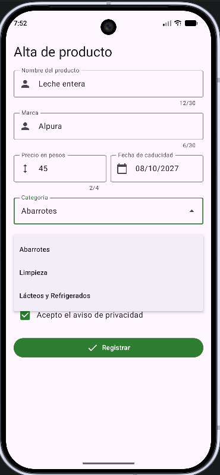
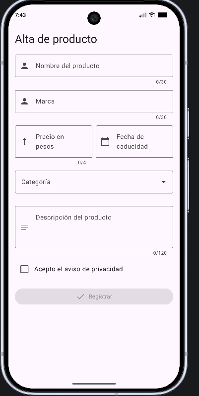
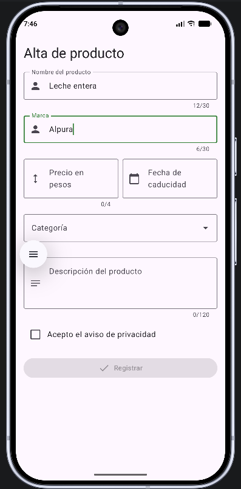
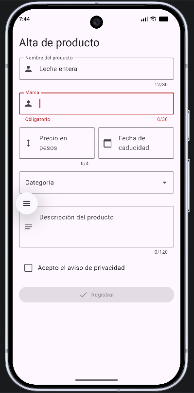
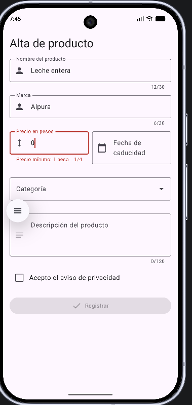
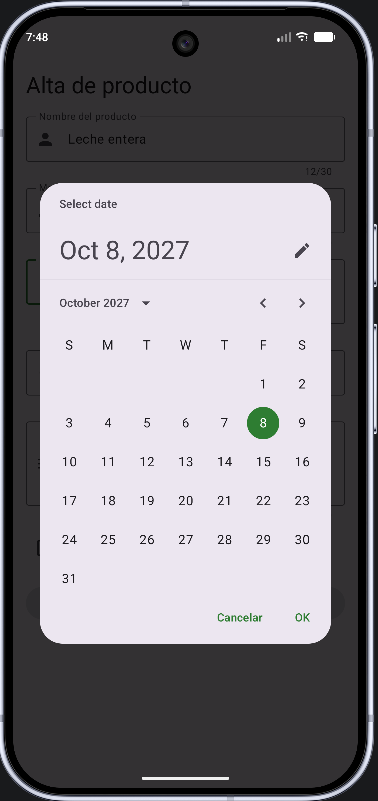
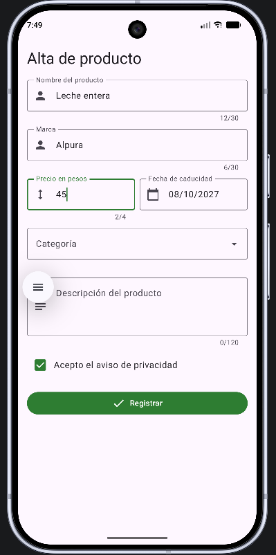
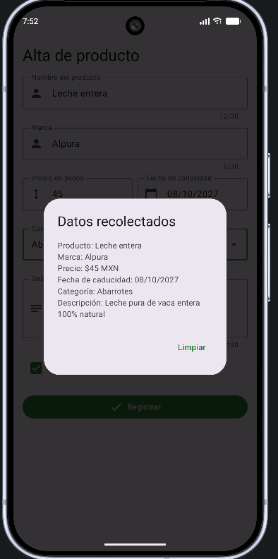
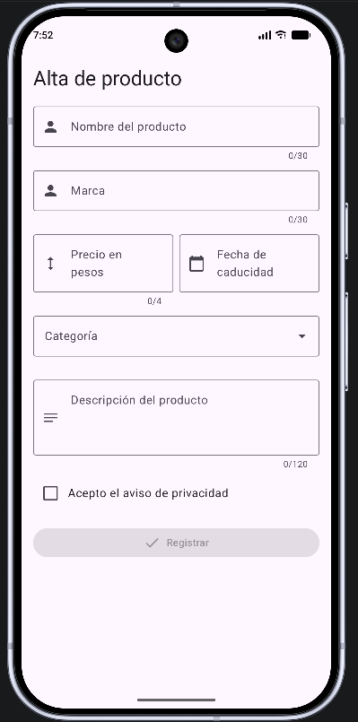

# Alta Producto — Formulario en Jetpack Compose

| | |
|---|---|
| **App** | Alta Producto (`com.utxicotepec.altaproducto`) |
| **Alumno** | Rubén Morales Reyes |
| **Matrícula** | 250854 |
| **GitHub** | [MonX030](https://github.com/MonX030) |
| **Asignatura** | Desarrollo de Aplicaciones Móviles · Unidad III · Semana 9 |
| **Contexto asignado** | **Dígito 4 — Alta de producto en una tienda** |

## Contexto asignado

| Elemento | Valor |
|---|---|
| Título del formulario | Alta de producto |
| Campo de texto 1 | Nombre del producto |
| Campo de texto 2 | Marca |
| Campo numérico | Precio en pesos (mínimo 1 peso) |
| Campo de fecha | Fecha de caducidad |
| Categoría | Abarrotes, Limpieza (+ Lácteos y Refrigerados en el punto extra) |
| Notas (opcional) | Descripción del producto |

## Arquitectura

Réplica del proyecto *JC Form* con Kotlin DSL, Jetpack Compose, Material 3 y `minSdk 26`.

```
app/src/main/java/com/utxicotepec/altaproducto/
├── MainActivity.kt        # Llama a MainView; Log.i con etiqueta "RMR"
├── MainScreen.kt          # MainView: estados, validaciones, guardado, limpieza
├── Producto.kt            # data class Producto (6 campos)
├── FakeUtils.kt           # Espera simulada del servidor
├── FormUtils.kt           # convertMillisToDate, foundErrors, productoFormatter
└── ui/
    ├── componentes/
    │   ├── Textfield.kt   # AntTextField y AntTfDate
    │   ├── Date.kt        # DatePickerModal (OK / Cancelar)
    │   ├── Dialog.kt      # AntDialogInfo (resumen + Limpiar)
    │   └── Dropdown.kt    # AntDropdown (punto extra)
    └── theme/             # AltaProductoTheme
```

Componentes reutilizados:

- **`AntTextField`**: campo con icono, contador de caracteres, validación y mensaje de error.
- **`AntTfDate`**: campo de solo lectura que abre el calendario al tocarlo.
- **`DatePickerModal`**: diálogo de calendario con botones OK y Cancelar.
- **`AntDialogInfo`**: ventana con el resumen de lo capturado y botón Limpiar.

Todos los textos visibles de la interfaz salen de `res/values/strings.xml`.

## Punto Extra implementado

El grupo de RadioButtons se sustituyó por un **menú desplegable de Material 3** (`ExposedDropdownMenuBox`) con tres categorías leídas del arreglo `profiles`: *Abarrotes*, *Limpieza* y *Lácteos y Refrigerados*. El botón **Limpiar** del diálogo reinicia también la categoría seleccionada.



## Evidencias de ejecución

**1. La app abre y muestra el título del contexto**


**2. Contador de caracteres en los campos de texto**


**3. Campo obligatorio vacío: borde rojo y mensaje**


**4. Valor menor al mínimo en el campo numérico**


**5. Calendario y fecha escrita en el campo**


**6. Botón Registrar apagado hasta marcar el checkbox**


**7. Indicador de progreso y diálogo con el resumen**


**8. Botón Limpiar vacía el formulario**

